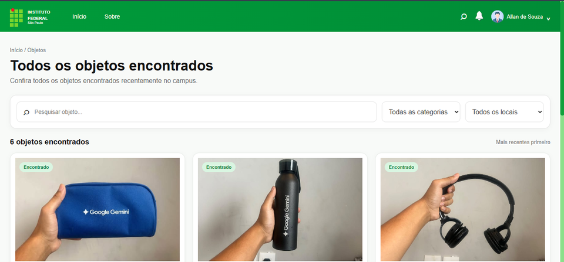
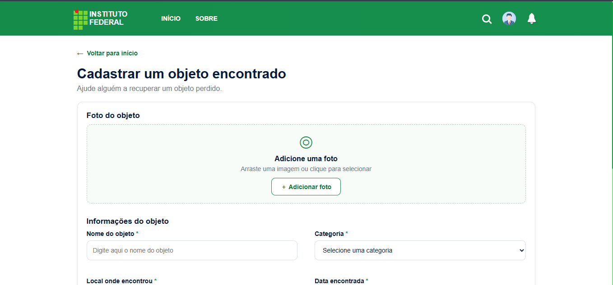

# Achados e Perdidos — IFSP

<p align="center">
  
</p>

<h3 align="center">Uma aplicação web para organizar o registro e a localização de objetos perdidos ou encontrados no ambiente acadêmico.</h3>

<p align="center">
  
  
  
  
  
</p>

---

## 📌 Sobre o projeto

O **Achados e Perdidos — IFSP** é um sistema web desenvolvido para facilitar a comunicação entre pessoas que perderam objetos e aquelas que encontraram algum item dentro de uma instituição de ensino.

A proposta é centralizar informações que normalmente ficam dispersas em conversas e avisos, oferecendo uma interface acessível e uma estrutura de dados relacional para organizar usuários, objetos, categorias, locais e ocorrências.

O projeto também é um exercício prático de desenvolvimento full stack, com foco especial em **Python, construção de APIs, integração com MySQL e modelagem de banco de dados relacional**.

## 🖥️ Demonstração de alguns visuais

### Tela de identificação

A página inicial permite que a pessoa se identifique para começar a utilizar o sistema.

<p align="center">
  
</p>

<p align="center"><em>Referência visual/protótipo da tela de identificação.</em></p>

### Tela de objetos cadastrados

<p align="center">
  
</p>

### Tela de cadastro de objeto

<p align="center">
  
</p>


## ✨ Funcionalidades e componentes

- **Identificação de usuário:** formulário com nome, matrícula, telefone e seleção de foto.
- **Envio de dados para a API:** comunicação do frontend com endpoints implementados em Flask.
- **Persistência de dados:** integração com MySQL por meio de `mysql-connector-python`.
- **Organização de objetos:** estrutura de dados para nome, descrição e categoria.
- **Registro de ocorrências:** modelagem para ocorrências do tipo `PERDIDO` e `ENCONTRADO`, associadas a usuário, objeto e local.
- **Categorias e locais:** tabelas dedicadas para manter essas informações organizadas.
- **Validação de datas no banco:** trigger que impede inserir uma ocorrência com data futura.
- **Verificação de disponibilidade:** endpoints de saúde para conferir a API e a conexão com o banco.
- **Interface web:** páginas construídas com HTML, CSS e JavaScript, com atenção à adaptação para dispositivos móveis.


## 🧰 Tecnologias utilizadas

| Tecnologia | Aplicação no projeto |
|---|---|
| **Python** | Linguagem do backend e organização da lógica da aplicação |
| **Flask** | Criação da aplicação web e dos endpoints da API |
| **Flask-CORS** | Configuração de comunicação entre origens no navegador |
| **MySQL** | Armazenamento relacional dos dados |
| **mysql-connector-python** | Conexão entre Python e MySQL |
| **python-dotenv** | Carregamento de configurações a partir de variáveis de ambiente |
| **Gunicorn** | Servidor WSGI para execução do Flask em ambiente de hospedagem |
| **HTML5, CSS3 e JavaScript** | Estrutura, estilo e interatividade da interface |
| **Git e GitHub** | Versionamento e documentação do projeto |


## 🗄️ Destaques técnicos: banco de dados MySQL

A modelagem relacional é um dos principais componentes deste projeto. O esquema `ACHADOS_E_PERDIDOS` foi dividido em entidades para reduzir a concentração de informações e representar os relacionamentos entre os dados.

### Entidades do modelo

| Tabela | Responsabilidade |
|---|---|
| `USUARIO` | Armazenar dados de identificação dos usuários |
| `CATEGORIA` | Classificar os objetos |
| `LOCAL` | Representar locais associados às ocorrências |
| `OBJETO` | Guardar nome, descrição e categoria do item |
| `OCORRENCIA` | Registrar se um objeto foi perdido ou encontrado, data, status e relações com usuário, objeto e local |

### Conceitos de banco de dados aplicados

- **Modelagem relacional:** divisão do domínio em entidades com responsabilidades específicas.
- **Chaves primárias:** identificação única dos registros.
- **Chaves estrangeiras:** relacionamentos entre ocorrências, usuários, objetos, locais e categorias.
- **Restrições de integridade:** uso de `NOT NULL`, `UNIQUE` e tipos enumerados para restringir valores.
- **Automação no banco:** trigger `TR_VERIFICA_DATA_OCORRENCIA`, que rejeita datas futuras.
- **Integração Python–MySQL:** conexão configurada fora da lógica das rotas e teste explícito de conectividade.
- **Scripts SQL versionados:** estrutura do banco mantida na pasta `database/`.

O esquema pode ser consultado em [`database/tables.sql`](database/tables.sql). Antes de executar scripts em qualquer ambiente com dados, revise os comandos: scripts de inicialização podem recriar o banco.


## ⚙️ Executar localmente

### Pré-requisitos

- Python 3.10 ou superior (recomendado);
- MySQL Server;
- Git;
- um navegador moderno.

### 1. Clonar o repositório

```bash
git clone https://github.com/allansouza07/Achados_Perdidos-IFSP.git
cd Achados_Perdidos-IFSP
```

### 2. Criar e ativar um ambiente virtual

**Windows (PowerShell):**

```powershell
python -m venv .venv
.\.venv\Scripts\Activate.ps1
```

**Linux/macOS:**

```bash
python3 -m venv .venv
source .venv/bin/activate
```

### 3. Instalar as dependências

```bash
pip install -r backend/requirements.txt
```

### 4. Configurar o banco de dados

Revise primeiro o script `database/tables.sql`. Ele contém comandos de criação do banco e tabelas; execute-o somente em um ambiente de desenvolvimento apropriado.

Configure as variáveis de ambiente utilizadas em `backend/config/database.py`. Crie o arquivo `backend/.env` com os valores do seu ambiente:

```env
DB_HOST=localhost
DB_PORT=3306
DB_USER=seu_usuario
DB_PASSWORD=sua_senha
DB_NAME=ACHADOS_E_PERDIDOS
```

Não compartilhe o arquivo `.env` nem credenciais reais no GitHub.

### 5. Iniciar a aplicação

```bash
cd backend
python app.py
```

Abra [http://127.0.0.1:5000](http://127.0.0.1:5000).

Para verificar a aplicação, acesse:

- [http://127.0.0.1:5000/api/health](http://127.0.0.1:5000/api/health)
- [http://127.0.0.1:5000/api/health/database](http://127.0.0.1:5000/api/health/database)

A segunda rota depende de um servidor MySQL acessível e de credenciais válidas.

## 🔐 Observações

Este projeto é acadêmico e não deve ser considerado pronto para produção sem uma revisão de segurança. Antes de utilizá-lo com dados reais:

## 🛣️ Próximos passos

- [ ] Consolidar a integração entre frontend, API e banco de dados em todos os fluxos.
- [ ] Garantir que os objetos cadastrados sejam persistidos e exibidos de forma consistente entre dispositivos.
- [ ] Implementar controle de autorização para que somente o responsável possa alterar o status de uma ocorrência.
- [ ] Revisar autenticação, privacidade e validação de dados.
- [ ] Ampliar os testes da API e do banco de dados.
- [ ] Atualizar as capturas de tela com imagens reais da aplicação publicada.

## 👨‍💻 Autor

**Allan Souza Gomes**  
Estudante de Análise e Desenvolvimento de Sistemas — IFSP.

Este projeto reúne prática de desenvolvimento web e aplicação de conhecimentos em **Python, APIs REST, modelagem relacional, SQL e integração com MySQL**.

- GitHub: [@allansouza07](https://github.com/allansouza07)
- Repositório: [Achados_Perdidos-IFSP](https://github.com/allansouza07/Achados_Perdidos-IFSP)
- Deploy: [Achados-perdidos](https://achados-perdidos-ifsp.vercel.app/frontend/todos_objetos/todos_objetos.html)

## 📄 Licença

Distribuído sob a licença MIT. Consulte o arquivo [LICENSE](LICENSE).
